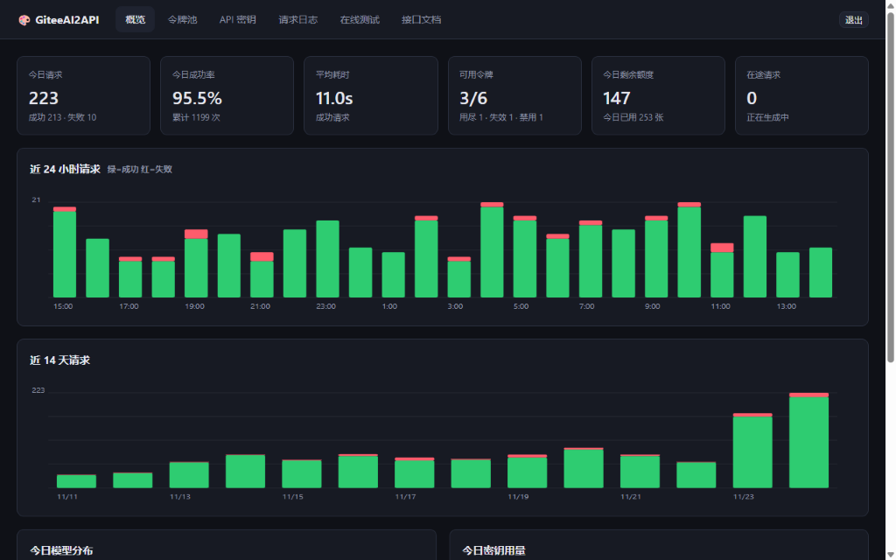
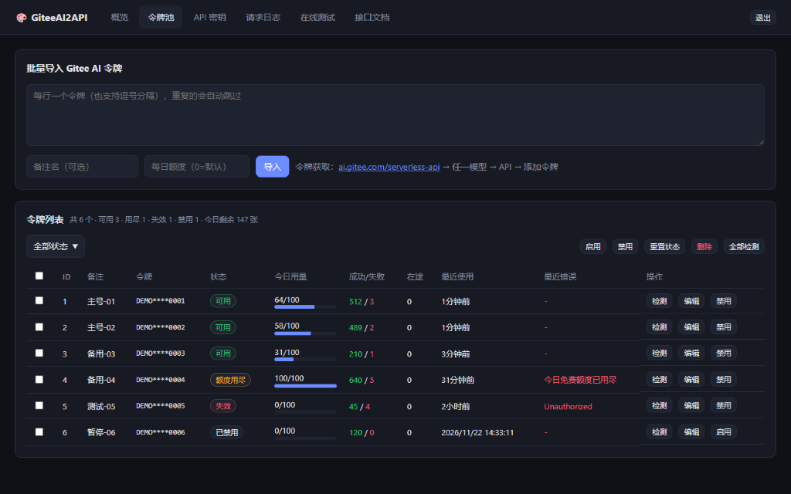
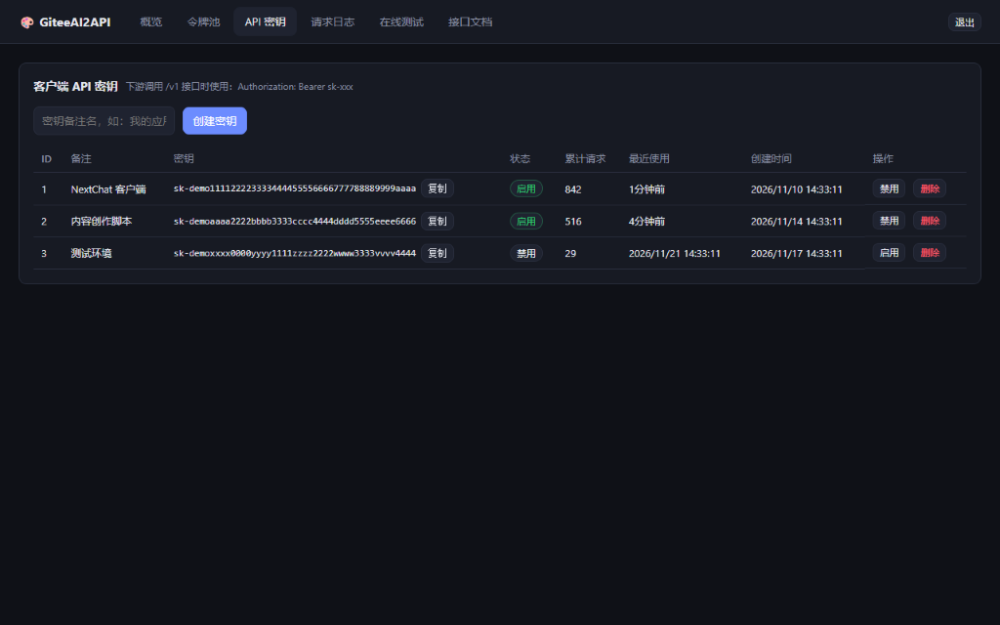
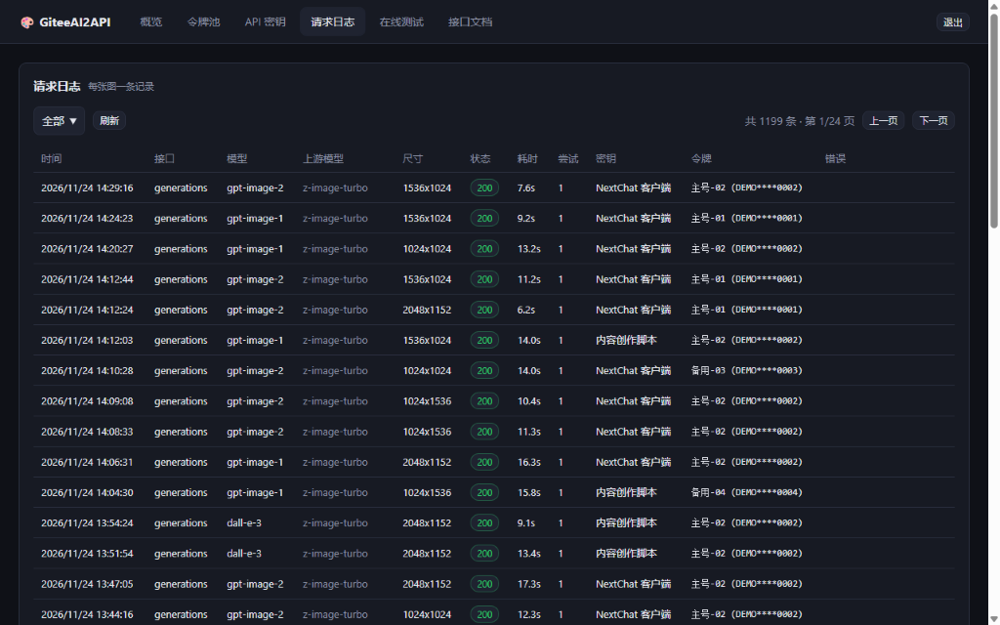

# GiteeAI2API

[](https://go.dev/)
[](./Dockerfile)
[](./LICENSE)

将 **Gitee AI（模力方舟）** 图像生成接口适配为兼容 **OpenAI Images API（适配 `gpt-image-2` 协议规范）** 的轻量级高并发 API 网关，面向个人与团队管理自有访问令牌、统一鉴权、故障转移与用量统计。

> 架构与接口调用参考：[wu529778790/freeimg.shenzjd.com](https://github.com/wu529778790/freeimg.shenzjd.com)

---

## 界面预览

### 概览大盘（实时统计 + 24 小时 / 14 天趋势）



### 令牌池管理（批量导入、额度监控、状态检测）



<details>
<summary>查看更多页面截图（API 密钥管理 / 请求日志）</summary>

#### API 密钥管理



#### 请求日志



</details>

---

## 核心特性

- **OpenAI Images API 深度兼容（模拟 `gpt-image-2`）**
  - `POST /v1/images/generations`：支持 `gpt-image-2`、`gpt-image-1.5`、`gpt-image-1`、`gpt-image-1-mini`、`dall-e-3`、`dall-e-2` 自动映射至 `z-image-turbo`（未命中映射的模型名原样透传给上游，支持 `MODEL_MAP` 自定义）。
  - 支持 `n`（1~10 并发生成）、`size`（`auto` 或任意 `WxH`，自动 16 对齐并等比缩放至 `MAX_SIDE`）、`quality`（`low`/`medium`/`high`/`auto`/`standard`/`hd` 映射推理步数）、`output_format`（`png`/`jpeg` 转码）、`output_compression`、`response_format`（`b64_json` / `url` 本地临时直链）、`stream=true`（OpenAI SSE 事件流）与 `usage` Token 估算。
  - 兼容扩展参数：`negative_prompt`、`num_inference_steps`、`guidance_scale`、`seed`。
  - `POST /v1/images/edits`：同时支持 `multipart/form-data` 和 JSON（`image_url` / Data URL），默认映射至 `Qwen-Image-Edit`。
  - `GET /v1/models`：返回可用模型列表，开箱接入各类 OpenAI 客户端与 SDK。
- **高并发令牌池与智能故障转移**
  - 最小在途数优先 + 轮询调度，支持单令牌并发上限与排队超时控制。
  - 每日额度统计（默认 100 张/天，北京时间 0 点自动清零并恢复 `exhausted` 状态令牌）。
  - 精细化错误分类：
    - `401` → 标记 `invalid`（失效），自动切换下一令牌；
    - 额度耗尽 → 标记 `exhausted`（次日自动恢复），自动切换下一令牌；
    - `429` 限流 / `5xx` / 网络抖动 → 短暂冷却（5~15s）并换令牌重试；
    - `400` / `422` 等参数或审核错误 → 直接返回，不浪费其他令牌额度。
- **内嵌单页管理后台（`/admin`）**
  - **概览大盘**：今日请求/成功率/平均耗时、令牌池健康度与剩余额度、在途并发、近 24 小时与近 14 天趋势图、模型/密钥/错误分布。
  - **令牌池管理**：批量导入（自动去重）、状态筛选、启用/禁用/改额度/重置/删除、单条与一键全量有效性检测（调用 `/models`，不消耗生图额度）。
  - **API 密钥管理**：创建/禁用/删除下游调用密钥（`sk-xxx`），同时兼容环境变量 `API_KEYS` 静态密钥。
  - **请求日志 / 在线测试 / 接口文档**：按状态分页查日志，内置生图测试面板。
- **轻量高性能架构**
  - 纯 Go 单二进制部署（前端页面 `go:embed` 内嵌），零外部中间件依赖。
  - SQLite WAL 读写分离 + 单协程异步批量事务落盘，高并发无写锁阻塞。

---

## 快速开始

### 方式一：Docker Compose（推荐）

```bash
git clone https://github.com/caiyaonan/giteeai2api.git
cd giteeai2api
cp .env.example .env
# 务必修改 .env 中的 ADMIN_PASSWORD
docker compose up -d --build
```

### 方式二：源码编译运行

需要 Go 1.24+：

```bash
cp .env.example .env
# 务必修改 .env 中的 ADMIN_PASSWORD
go build -trimpath -ldflags="-s -w" -o giteeai2api .
./giteeai2api
```

---

## 首次使用

1. 浏览器访问管理后台：`http://localhost:8080/admin`（使用 `.env` 中设置的 `ADMIN_PASSWORD` 登录）。
2. 准备您本人合法持有的 Gitee AI 访问令牌：
   - 登录 [https://ai.gitee.com/serverless-api](https://ai.gitee.com/serverless-api) → 选择模型 → 点击「API」→「添加令牌」。
   - 令牌可用额度与计费策略以 Gitee AI 官方平台实时规则为准。
3. 在后台「**令牌池**」批量粘贴导入令牌，可点击「全部检测」确认有效。
4. 在后台「**API 密钥**」创建一个 `sk-xxx` 密钥，即可在任意支持 OpenAI Images API 的客户端中使用。

---

## 接口调用示例

Base URL：`http://localhost:8080/v1`  
鉴权：`Authorization: Bearer sk-your-key`（或 `x-api-key: sk-your-key`）

### cURL（文生图）

```bash
curl http://localhost:8080/v1/images/generations \
  -H "Authorization: Bearer sk-your-key" \
  -H "Content-Type: application/json" \
  -d '{
    "model": "gpt-image-2",
    "prompt": "一只戴着宇航员头盔的橘猫漂浮在太空中，电影级光影，超高清",
    "size": "1536x1024",
    "quality": "high",
    "output_format": "png",
    "n": 1
  }'
```

### cURL（图片编辑）

```bash
curl http://localhost:8080/v1/images/edits \
  -H "Authorization: Bearer sk-your-key" \
  -F "model=gpt-image-2" \
  -F "image[]=@input.png" \
  -F "prompt=把背景换成海边日落"
```

### Python（OpenAI SDK）

```python
import base64
from openai import OpenAI

client = OpenAI(
    base_url="http://localhost:8080/v1",
    api_key="sk-your-key",
)

resp = client.images.generate(
    model="gpt-image-2",
    prompt="赛博朋克雨夜街头，霓虹倒影，8K 写实",
    size="1024x1024",
    quality="medium",
    n=1,
)

with open("output.png", "wb") as f:
    f.write(base64.b64decode(resp.data[0].b64_json))
```

### Node.js（OpenAI SDK）

```js
import fs from "node:fs";
import OpenAI from "openai";

const client = new OpenAI({
  baseURL: "http://localhost:8080/v1",
  apiKey: "sk-your-key",
});

const resp = await client.images.generate({
  model: "gpt-image-2",
  prompt: "水彩风格的中国江南古镇清晨",
  size: "1024x1536",
  quality: "high",
});

fs.writeFileSync("output.png", Buffer.from(resp.data[0].b64_json, "base64"));
```

### 流式输出（`stream: true`）

传入 `"stream": true` 时以 SSE 返回，每生成完一张图立即推送事件（同时每 15 秒发送 `: ping` 保活）：

```text
event: image_generation.completed
data: {"type":"image_generation.completed","b64_json":"...","size":"1024x1024","quality":"medium","output_format":"png","usage":{...}}
```

---

## 环境变量配置

完整模板见 [.env.example](./.env.example)，本地运行与 Docker 部署均自动加载 `.env`（系统环境变量优先级高于 `.env`）：

| 变量名 | 默认值 | 说明 |
| --- | --- | --- |
| `ADDR` | `:8080` | 服务监听地址 |
| `DATA_DIR` | `./data` | SQLite 数据库与临时图片存储目录 |
| `ADMIN_PASSWORD` | `admin123` | 管理后台登录密码（**部署前务必修改**） |
| `API_KEYS` | *(空)* | 静态客户端密钥，逗号分隔（也可在后台动态管理） |
| `UPSTREAM_BASE` | `https://ai.gitee.com/v1` | Gitee AI 上游 API 地址 |
| `DEFAULT_MODEL` | `z-image-turbo` | 文生图默认上游模型 |
| `EDIT_MODEL` | `Qwen-Image-Edit` | 改图默认上游模型 |
| `MODEL_MAP` | *(空)* | 自定义模型映射，逗号分隔，如 `my-img=z-image-turbo` |
| `TOKEN_DAILY_LIMIT` | `100` | 单令牌每日默认额度（`0` 为不限） |
| `TOKEN_CONCURRENCY` | `2` | 单令牌最大并发请求数 |
| `MAX_RETRIES` | `3` | 单张图失败后自动换令牌重试次数 |
| `QUEUE_TIMEOUT_SEC` | `60` | 令牌全忙时的最大排队等待时间（秒） |
| `UPSTREAM_TIMEOUT_SEC` | `180` | 单次上游请求超时时间（秒） |
| `DEFAULT_SIZE` | `1024x1024` | `size=auto` 或省略时的默认尺寸 |
| `MAX_SIDE` | `2048` | 最大边长限制（超出等比缩放） |
| `QUALITY_STEPS` | `low=6,medium=9,high=12` | 质量档位与推理步数映射 |
| `DEFAULT_NEGATIVE_PROMPT` | *(空)* | 默认负面提示词 |
| `PUBLIC_BASE_URL` | *(空)* | `response_format=url` 时的对外域名（留空则自动推断） |
| `IMAGE_TTL_HOURS` | `24` | 临时缓存图片自动清理周期（小时） |
| `LOG_RETENTION_DAYS` | `30` | 请求日志保留天数 |

---

## 兼容边界说明

- **透明背景**：上游模型不支持透明通道，`background=transparent` 将回退为 `opaque` 并在响应中如实返回。
- **WebP 编码**：`output_format=png` / `jpeg` 支持自动转码与压缩；`webp` 暂不重新编码，会保留上游原格式并在响应 `output_format` 中如实标明。

---

## 安全建议与免责声明

### 安全建议
- **严禁提交敏感文件**：请勿将 `.env`、`data/` 或任何 `*.db` 文件提交至公开仓库（已在 `.gitignore` 与 `.dockerignore` 中默认排除）。
- **生产部署加固**：部署前务必修改默认 `ADMIN_PASSWORD`，并通过 Nginx / Caddy 等反向代理启用 HTTPS，避免明文传输管理凭证与 API 密钥。

### 免责声明（Disclaimer）
1. **非官方声明**：本项目为独立的第三方开源协议适配工具，与 **OpenAI**、**Gitee / Gitee AI（模力方舟）** 均无任何官方关联、授权或背书关系。文中提及的 `gpt-image-2`、`dall-e-3` 等名称仅用于说明 OpenAI API 接口参数兼容性，相关商标归其各自所有者所有。
2. **合规使用**：本项目仅用于技术学习、协议适配与个人/团队管理**自身合法持有的官方访问令牌**。使用者应严格遵守所在国家/地区法律法规及上游平台的服务条款（ToS），不得将本项目用于绕过平台风控、违规批量注册、恶意刷量或任何侵权违法用途。
3. **内容与责任豁免**：本项目仅作为本地自托管的 API 转发网关，不提供、不内置、不代理任何第三方账号或令牌，也不对用户输入提示词及上游模型生成的内容承担审查或法律责任。因违规使用、凭证保管不当或上游接口变更导致的任何直接或间接损失，均由使用者自行承担。
4. **权利人通知**：如上游平台或相关权利人认为本项目存在任何不妥之处，请通过 Issue 联系，我们将在核实后第一时间配合处理或下架。

## License

本项目基于 [MIT License](./LICENSE) 开源。

